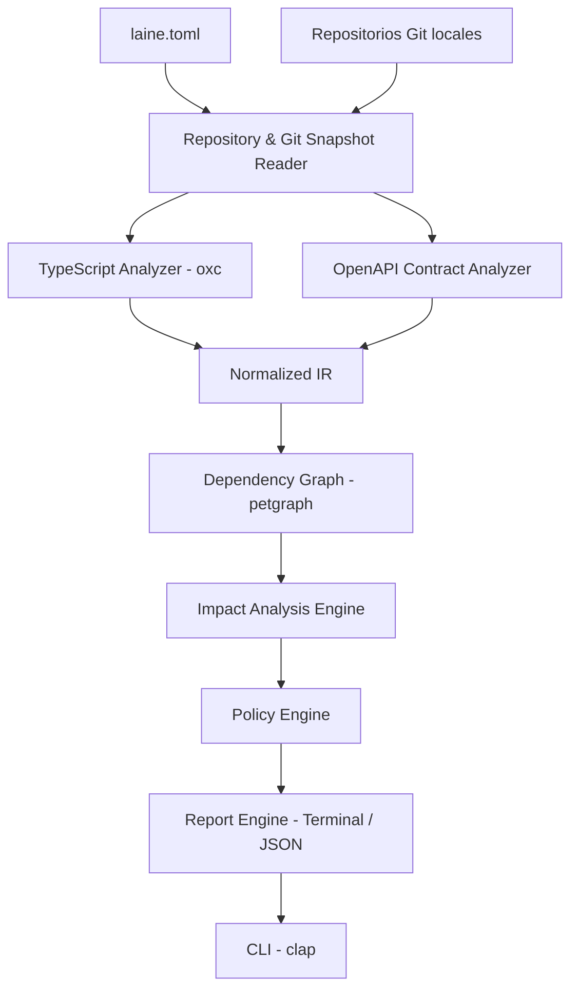

# Laine — Change Impact Analyzer

> Plan de producto, arquitectura y desarrollo de una herramienta CLI open source, escrita en **Rust**, para detectar y explicar el impacto de cambios de código entre repositorios independientes.

**Estado:** plan v2 (revisado para Rust + *vertical slice first*) · **Nombre provisional:** `Laine` · **Objetivo:** Portafolio técnico de nivel Senior/Staff → lanzamiento Open Source distribuible como binario único.

---

## Índice

1. [Visión y problema](#1-visión-y-problema)
2. [Cómo funciona (explicación simple)](#2-cómo-funciona-explicación-simple)
3. [Propuesta de valor y nicho real](#3-propuesta-de-valor-y-nicho-real)
4. [Principios de diseño](#4-principios-de-diseño)
5. [Arquitectura del sistema](#5-arquitectura-del-sistema)
6. [Modelo del grafo y formato intermedio (IR)](#6-modelo-del-grafo-y-formato-intermedio-ir)
7. [Decisiones técnicas clave del MVP](#7-decisiones-técnicas-clave-del-mvp)
8. [Stack tecnológico (Rust)](#8-stack-tecnológico-rust)
9. [Experiencia de uso](#9-experiencia-de-uso)
10. [Estructura del repositorio](#10-estructura-del-repositorio)
11. [Roadmap (Vertical Slice First)](#11-roadmap-vertical-slice-first)
12. [Criterios de aceptación de la Fase 1](#12-criterios-de-aceptación-de-la-fase-1)
13. [Pruebas, benchmarks y documentación](#13-pruebas-benchmarks-y-documentación)
14. [Riesgos y limitaciones](#14-riesgos-y-limitaciones)

---

## 1. Visión y problema

En empresas con múltiples repositorios y microservicios, un cambio pequeño en un servicio —como eliminar un campo de una respuesta HTTP, cambiar su tipo o modificar una ruta— puede pasar todas las pruebas locales de ese repositorio y aun así romper sistemas de otros equipos al llegar a producción.

**Laine** actúa como un radar de efecto dominó que se ejecuta antes de publicar el cambio, respondiendo:

- ¿Qué contratos o campos cambiaron de forma incompatible entre dos revisiones de Git?
- ¿Qué otros repositorios consumen ese endpoint y utilizan exactamente el campo modificado?
- ¿En qué archivo, línea y revisión exacta existe evidencia de esa dependencia?
- ¿Qué consumidores indirectos podrían verse afectados?
- ¿Qué llamadas dinámicas no pudieron resolverse y requieren revisión humana?

### Usuarios objetivo

- Senior Software Engineers, Tech Leads y arquitectos de software.
- Platform Engineers y equipos DevOps.
- Organizaciones con múltiples repositorios REST que buscan visibilidad *cross-repo* rápida y local.

---

## 2. Cómo funciona (explicación simple)

Imagina una empresa con cuatro proyectos separados en carpetas Git locales: `customer-service`, `billing-service`, `notification-service` y `shipping-service`.

Un desarrollador edita `customer-service` y elimina el campo `fullName` de `GET /customers/:id` (sustituyéndolo por `firstName` y `lastName`). Antes de subir su cambio, ejecuta `laine analyze`:

1. **Detecta qué cambió en `customer-service`:** compara la versión anterior (`main`) contra la versión nueva (`head`) directamente desde el historial de Git y detecta que `fullName` fue eliminado de `GET /customers/:id`.
2. **Inspecciona los demás repositorios:** analiza el código de `billing-service`, `notification-service` y `shipping-service`, identifica qué llamadas HTTP apuntan a `GET /customers/:id` y rastrea qué campos de la respuesta se leen.
3. **Cruza ambos lados y genera el reporte:**
   - **Afectados confirmados:** `billing-service` (línea 42) y `notification-service` (línea 18), que leen `fullName`.
   - **Sin impacto:** `shipping-service`, que consume el mismo endpoint pero solo lee `address`.
   - **No resueltos (`UNKNOWN`):** cualquier llamada cuya URL se construya dinámicamente y no pueda verificarse con certeza.

```text
  [1. Diff de contratos]          [2. Análisis de consumidores]
  "fullName eliminado de          "billing-service lee fullName (L42)"
   GET /customers/:id"            "notification-service lee fullName (L18)"
           \                                  /
            ▼                                ▼
            [3. Cruce en el Grafo de Dependencias]
                              │
                              ▼
       "BREAKING CHANGE: 2 consumidores directos afectados"
```

---

## 3. Propuesta de valor y nicho real

### Panorama existente

| Solución | Qué resuelve bien | Brecha frente a Laine |
|---|---|---|
| **oasdiff** | Detecta *breaking changes* en especificaciones OpenAPI. | No sabe qué repositorios ni qué líneas de código consumen los campos modificados. |
| **Nx / Turborepo** | Identifica proyectos afectados dentro de un monorepo. | No cruza fronteras HTTP entre repositorios independientes. |
| **Pact / PactFlow** | Contract testing guiado por consumidores. | Requiere escribir y mantener pruebas de contrato en todos los equipos y brokers. |
| **Buf / GraphQL (Apollo, Hive)** | Contratos estrictos y telemetría de uso de campos. | Exigen migrar a gRPC o GraphQL. |
| **Sourcegraph (SCIP)** | Navegación semántica cross-repo a escala. | Enfocado en búsqueda de símbolos, no en análisis de impacto de contratos REST. |

### Nicho diferencial

Laine apunta a **equipos reales con microservicios REST en múltiples repositorios**, sin Pact ni SDKs generados, que quieren detectar impactos *cross-repo* en **milisegundos**, de forma **local/self-hosted**, con un **único binario** y sin enviar código propietario a terceros.

---

## 4. Principios de diseño

- **Sin IA en el motor principal:** resultados deterministas y reproducibles para los mismos commits, configuración y versión.
- **Evidencia verificable:** cada hallazgo incluye repositorio, commit, archivo, línea y ruta de dependencias.
- **Honestidad ante la incertidumbre:** distinguir explícitamente hechos comprobados de inferencias y de lo no resoluble; nunca confirmar una dependencia por coincidencia de texto.
- **Separación de certeza y severidad:** un cambio puede estar `CONFIRMED` y ser de severidad baja, o ser `POSSIBLE` y crítico.
- **Local-first y seguro:** no ejecuta código analizado, no corre scripts ni `npm install`, y no modifica el directorio de trabajo del usuario.
- **Precisión sobre volumen:** preferir menos alertas confiables que ruido con falsos positivos.

---

## 5. Arquitectura del sistema

La arquitectura separa la lectura de Git, los analizadores por lenguaje/contrato, el modelo intermedio (IR), el grafo de dependencias, el motor de impacto y la presentación.



| Componente | Responsabilidad |
|---|---|
| **Git Snapshot Reader** | Resolver commits `base`/`head` y leer archivos directo desde objetos Git en memoria sin alterar el working tree. |
| **OpenAPI Analyzer** | Parsear especificaciones OpenAPI, normalizar endpoints y comparar contratos entre revisiones. |
| **TypeScript Analyzer (`oxc`)** | Parsear TS/JS, resolver scopes/símbolos, detectar rutas Express, llamadas `fetch`/Axios y rastrear accesos a campos (`READS_FIELD`). |
| **Normalized IR** | Formato intermedio independiente del lenguaje para nodos, relaciones, contratos y evidencia (inspirado en SCIP). |
| **Dependency Graph** | Grafo dirigido (`petgraph`) con consultas directas, inversas, recorridos transitivos (BFS/DFS) y manejo de ciclos. |
| **Impact Engine** | Detectar cambios semánticos/contractuales, propagar impacto, calcular niveles de certeza y recolectar relaciones no resueltas. |
| **Policy & Report Engine** | Evaluar severidad/exit codes y emitir salida humana en terminal y JSON versionado. |

---

## 6. Modelo del grafo y formato intermedio (IR)

### Nodos principales (MVP)

| Nodo | Ejemplo |
|---|---|
| `Repository` | `customer-service` |
| `File` | `src/invoices/customer.ts` |
| `Function` | `getInvoiceCustomer` |
| `Endpoint` | `GET customer-service /customers/:id` |
| `SchemaField` | `GET customer-service /customers/:id :: response.200.fullName` |
| `UnresolvedCall` | `billing-service/src/client.ts:88 (dynamic URL)` |

### Relaciones principales (MVP)

| Relación | Significado |
|---|---|
| `EXPOSES` | Un servicio/archivo expone un `Endpoint`. |
| `RETURNS_FIELD` | Un `Endpoint` devuelve un `SchemaField` (con su tipo y obligatoriedad). |
| `CONSUMES` | Una función/archivo realiza una llamada HTTP a un `Endpoint`. |
| `READS_FIELD` | Una función/archivo lee un `SchemaField` proveniente de una respuesta HTTP. |
| `CALLS` | Una función invoca a otra (para propagación indirecta / helpers). |

### Niveles de certeza

| Nivel | Significado |
|---|---|
| `CONFIRMED` | Evidencia directa en código y contrato dentro del alcance del analizador (no garantiza fallo en runtime, pero sí incompatibilidad estructural verificable). |
| `LIKELY` | Dependencia fuerte con algún paso inferido (p. ej. wrapper o alias de configuración). |
| `POSSIBLE` | Impacto indirecto (consumidor de un consumidor) o evidencia parcial. |
| `UNKNOWN` | URL dinámica o patrón fuera de alcance; se reporta explícitamente para revisión manual. |

---

## 7. Decisiones técnicas clave del MVP

Para evitar los cuellos de botella clásicos del análisis estático, el MVP fija tres decisiones explícitas:

1. **Fuente de verdad en el productor:**
   - **OpenAPI** es la fuente contractual primaria del MVP para comparar `base` vs `head` con alta precisión.
   - En la Fase 2 se suma extracción de rutas **Express** con patrones explícitos para señalar discrepancias entre código y OpenAPI, y cubrir endpoints sin especificación.
2. **Alcance del *data-flow* en consumidores TypeScript/JavaScript:**
   - Se rastrea el flujo de datos desde llamadas `fetch(...)` y `axios.{get,post,put,patch,delete}(...)` (e instancias `axios.create({ baseURL })`).
   - Patrones soportados en el MVP:
     - Acceso directo: `customer.fullName`, `response.data.fullName`
     - Desestructuración: `const { fullName } = customer`
     - Reasignación/alias local: `const c = customer; c.fullName`
     - Propagación a helpers locales dentro del mismo archivo/módulo (1–2 niveles)
   - Todo lo que escape a estos patrones (URLs construidas dinámicamente desde DB/runtime, reflexión, acceso por clave calculada `customer[key]`) se clasifica como `UNKNOWN` / `POSSIBLE`, nunca como falso `CONFIRMED`.
3. **Sin dependencia de `node_modules`:**
   - Al usar `oxc` + lectura de blobs Git en memoria (`gix`/`git2`) + OpenAPI, analizar dos commits nunca requiere ejecutar `npm install` ni depende de `.d.ts` externos.

---

## 8. Stack tecnológico (Rust)

| Tecnología / Crate | Responsabilidad | Etapa |
|---|---|---|
| **Rust** (stable) | Lenguaje único del motor y la CLI; binario nativo sin runtime externo. | MVP |
| **`oxc_parser` + `oxc_semantic` + `oxc_resolver`** | AST, scopes, bindings, símbolos y resolución de módulos TS/JS a velocidad nativa. | MVP |
| **`gix` (gitoxide)** o **`git2`** | Resolución de commits y lectura de blobs Git en memoria sin tocar el working tree. | MVP |
| **`openapiv3` / `oas3`** + **`serde`** | Parseo y comparación de contratos OpenAPI (YAML y JSON). | MVP |
| **`petgraph`** | Grafo dirigido de dependencias, BFS/DFS, detección de ciclos y rutas de impacto. | MVP |
| **`clap`** | Interfaz CLI ergonómica con subcomandos, flags y ayuda autogenerada. | MVP |
| **`rayon`** | Paralelización automática del análisis por repositorio y archivo. | MVP / Fase 3 |
| **`rusqlite`** | Persistencia local del índice en SQLite embebido (sin servicios externos). | Fase 3 |
| **`miette` / `owo-colors`** | Reportes de terminal claros y legibles con contexto de archivo y línea. | MVP / Fase 3 |
| **`tree-sitter`** | Soporte multilenguaje nativo en Rust (Go, Python, Java). | Post-v1 |

> **Nota práctica:** Fijar versiones exactas de `oxc_*` y `gix` en `Cargo.toml` y validar siempre con `cargo test` para evitar roturas por cambios entre versiones menores.

---

## 9. Experiencia de uso

### Configuración (`laine.toml`)

```toml
version = 1

[[services]]
name = "customer-service"
path = "./fixtures/customer-service"
openapi = "openapi.yaml"
base_urls = [
  "http://customer-service",
  "https://api.company.internal/customers"
]

[[services]]
name = "billing-service"
path = "./fixtures/billing-service"

[[services]]
name = "notification-service"
path = "./fixtures/notification-service"

[[services]]
name = "shipping-service"
path = "./fixtures/shipping-service"
```

### Comandos CLI

```bash
# Inicializar configuración base
laine init

# Registrar un repositorio
laine repo add ./customer-service --name customer-service --base-url http://customer-service

# Analizar impacto de un cambio entre dos revisiones
laine analyze \
  --repo customer-service \
  --base main \
  --head feature/split-customer-name

# Exportar salida estructurada para CI o scripts
laine analyze \
  --repo customer-service \
  --base main \
  --head feature/split-customer-name \
  --format json
```

### Ejemplo de salida en terminal

```text
Laine v0.1.0 — Cross-Repo Impact Analysis
Target: customer-service (main -> feature/split-customer-name)
Analyzed: 4 repos | 48 files | 19 ms

BREAKING CHANGE [CONFIRMED]
  Endpoint: GET /customers/:id
  Change:   Removed response field `fullName` (string)
  Source:   customer-service/openapi.yaml (commit 9f3a1c2)

  Affected consumers (2 confirmed):
    1. billing-service
       File: billing-service/src/invoices/customer.ts:42
       Read: customer.fullName
       Path: GET /customers/:id <- fetch() @ L40 <- read `fullName` @ L42

    2. notification-service
       File: notification-service/src/email/welcome.ts:18
       Read: response.data.fullName
       Path: GET /customers/:id <- axios.get() @ L15 <- read `fullName` @ L18

UNRESOLVED CALLS (1)
  - billing-service/src/legacy/sync.ts:63 (dynamic URL: cannot resolve statically)

RESULT: INCOMPATIBLE CHANGE (exit code 2)
```

---

## 10. Estructura del repositorio

Workspace Rust minimalista (3 crates) para evitar sobreingeniería al inicio y permitir extracción limpia cuando crezca:

```text
laine/
├── Cargo.toml                     # Workspace root
├── PLAN.md                        # Este plan
├── README.md
├── LICENSE
├── crates/
│   ├── laine-core/            # Dominio, IR, lector Git, diff OpenAPI, grafo petgraph, motor de impacto
│   ├── laine-ts/              # Analizador TS/JS con oxc (fetch, Axios, data-flow, rutas Express)
│   └── laine-cli/             # Binario CLI (clap), carga de laine.toml, reportes terminal/JSON
├── fixtures/
│   └── demo-workspace/            # Script/generador de los 4 repos Git reproducibles
├── tests/                         # Tests de integración end-to-end y golden tests JSON
├── benches/                       # Benchmarks reproducibles (Criterion)
└── docs/
    ├── adr/                       # Architecture Decision Records
    └── ir-spec.md                 # Especificación del formato intermedio y reporte JSON
```

---

## 11. Roadmap (Vertical Slice First)

El roadmap prioriza validar el **análisis cross-repo desde la Fase 1**, en lugar de posponerlo para el final.

### Fase 0 — Setup y Fixtures Reproducibles
- [x] Inicializar workspace Rust (`laine-core`, `laine-ts`, `laine-cli`) con versiones fijadas.
- [x] Crear un generador reproducible en `fixtures/` que materialice 4 repositorios Git independientes:
  - `customer-service` (commit `v1` con `fullName`, commit `v2` reemplazándolo por `firstName`/`lastName`).
  - `billing-service` (consume `GET /customers/:id` con `fetch` y lee `fullName`, más una llamada dinámica no resoluble).
  - `notification-service` (consume `GET /customers/:id` con `axios.get` y lee `response.data.fullName`).
  - `shipping-service` (consume `GET /customers/:id` pero solo lee `address` — caso negativo).

### Fase 1 — Vertical Slice Cross-Repo (Core MVP)
- [x] Leer `laine.toml` y abrir los repositorios Git sin modificar el working directory.
- [x] Extraer y comparar contratos OpenAPI entre `--base` y `--head` (campos eliminados, endpoints eliminados, cambios de tipo incompatibles).
- [x] Implementar analizador TS/JS con `oxc_parser` + `oxc_semantic`:
  - Detectar llamadas `fetch` y `axios.get/post/put/patch/delete`.
  - Normalizar URLs contra `base_urls` registrados (`/customers/${id}` → `/customers/:id`).
  - Marcar URLs no resolubles como `UnresolvedCall` (`UNKNOWN`).
  - Rastrear lecturas de campos (`customer.fullName`, `response.data.fullName`, desestructuración).
- [x] Construir el grafo en memoria con `petgraph` y cruzar cambios del productor con consumidores.
- [x] Emitir reporte en terminal y JSON versionado con evidencia exacta (`repo`, `commit`, `file`, `line`, `path`).

**Resultado:** demostración real end-to-end funcionando en milisegundos sobre 4 repos Git independientes.

### Fase 2 — Profundidad Semántica y Precisión
- [ ] Mejorar *data-flow*: alias locales, `axios.create({ baseURL })`, constantes de URL, variables de entorno mapeadas en configuración y paso de respuesta a funciones helper (1–2 niveles).
- [ ] Añadir extracción de rutas Express (`app.get`, `router.get`, `app.use('/prefix', router)`) y reportar discrepancias entre código y OpenAPI.
- [ ] Propagación indirecta (`POSSIBLE`) cuando un servicio consumidor expone datos a un tercero.
- [ ] Suite completa de tests: golden tests JSON, casos negativos, ciclos, símbolos homónimos y rutas ambiguas.

**Resultado:** motor confiable y defendible ante revisión de ingenieros senior.

### Fase 3 — CLI Completa, Políticas, Persistencia y Benchmarks
- [ ] Subcomandos completos: `init`, `repo add`, `index`, `analyze`, `report`.
- [ ] Motor de políticas (severidad, reglas de bloqueo, códigos de salida: `0` limpio, `2` breaking change, `1` error técnico).
- [ ] Paralelismo con `rayon` y persistencia/caché local opcional en SQLite (`rusqlite`) por commit SHA.
- [ ] Benchmarks reproducibles con `criterion` (tiempo de indexación, tiempo de análisis, memoria pico).

**Resultado:** MVP listo para portafolio y primeros usuarios reales.

### Fase 4 — Integración CI y Lanzamiento Open Source
- [ ] GitHub Action oficial que comenta/publica checks en Pull Requests.
- [ ] Builds automatizados y releases binarios (Linux, macOS, Windows) + instalación simple.
- [ ] Documentación pública: README con demo reproducible, ADRs, especificación del IR y comparativa técnica honesta.

**Resultado:** lanzamiento público v0.1 / v1.0 open source.

### Fase 5 — Evolución Post-v1
- [ ] Soporte multilenguaje con `tree-sitter` (Python, Go, Java) reutilizando el mismo IR.
- [ ] Protocolos adicionales: GraphQL, gRPC y eventos asíncronos.
- [ ] Correlación opcional con trazas reales de OpenTelemetry.
- [ ] Ownership (`CODEOWNERS`) para sugerir revisores afectados y selección de tests.

---

## 12. Criterios de aceptación de la Fase 1

La Fase 1 se considera completa cuando todas estas pruebas pasan automáticamente (`cargo test`):

- [x] Detecta la eliminación de `fullName` en `GET /customers/:id` entre dos commits de `customer-service` sin modificar el working directory.
- [x] Reporta `billing-service` y `notification-service` como afectados `CONFIRMED` con archivo, línea, commit y ruta de dependencias.
- [x] **No** reporta `shipping-service` como afectado (consume el endpoint pero solo lee `address`).
- [x] Reporta llamadas con URL dinámica como `UNKNOWN` (no resueltas) sin falsos positivos.
- [x] Produce salida determinista idéntica en ejecuciones repetidas (verificada con golden tests en JSON).
- [x] El análisis completo de los 4 repositorios se ejecuta localmente sin requerir `node_modules` ni acceso a internet.

---

## 13. Pruebas, benchmarks y documentación

- **Unitarias:** normalizador de rutas, diff de OpenAPI, extractor `oxc`, *data-flow* de campos y consultas del grafo.
- **Integración end-to-end:** sobre repositorios Git reales generados en `fixtures/`.
- **Golden tests:** snapshots exactos del JSON de salida para garantizar determinismo y evitar regresiones.
- **Métricas a medir con benchmarks reales:** precisión, recall en fixtures, tasa de falsos positivos, cobertura de llamadas resueltas vs `UNKNOWN`, tiempo total (ms) y memoria pico (MB).
- **Documentación para portafolio Senior/Staff:** ADRs explicando por qué Rust + `oxc`, por qué OpenAPI-first en el productor, límites del análisis estático y trade-offs frente a Pact/SCIP.

---

## 14. Riesgos y limitaciones

| Riesgo | Mitigación |
|---|---|
| URLs dinámicas / configuración externa | Soportar mapeos explícitos en `laine.toml` y marcar el resto como `UNKNOWN`. |
| Wrappers propios de HTTP (`apiClient.get`) | Soportar wrappers simples por seguimiento de funciones locales y permitir declaraciones en configuración en Fase 2. |
| Contratos OpenAPI desactualizados | Contrastar rutas contra el analizador Express (Fase 2) y reportar discrepancias explícitamente. |
| Cambios de API en crates jóvenes (`oxc_*`, `gix`) | Fijar versiones exactas en `Cargo.toml` y aislar el acceso detrás de módulos propios. |
| Exposición de secretos en reportes | Ejecución 100% local y nunca incluir valores de variables de entorno o payloads en la salida. |

**Límite fundamental:** el análisis estático no puede garantizar ausencia total de fallos en producción. Un resultado limpio significa *"sin incompatibilidades detectadas dentro de la cobertura analizada"*, nunca una garantía absoluta.
