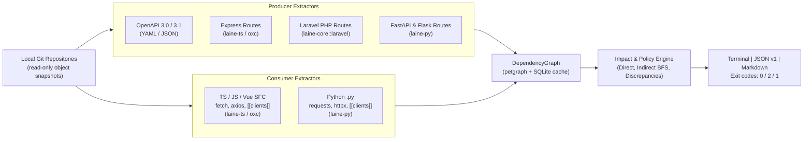

# Laine

Cross-repository API change impact analyzer written in Rust that pinpoints breaking contract changes and affected downstream consumers with exact file, line, and commit evidence—locally, deterministically, and without running untrusted code.

[](https://github.com/Klowsx/impact-analizer/actions/workflows/ci.yml)
[](./LICENSE)

---

## Architecture

Laine reads Git snapshots directly from local object databases (`git cat-file --batch`, never mutating working trees or installing dependencies), normalizes producer contracts and consumer HTTP calls into a language-agnostic Intermediate Representation (IR), and evaluates breaking changes over a directed `petgraph` dependency graph.



---

## Supported Languages & Frameworks

| Side | Language / Format | Frameworks & Clients | What Laine Extracts |
|---|---|---|---|
| **Producer** | OpenAPI 3.0 / 3.1 (YAML & JSON) | **Any backend language** (Go, Java, Rust, .NET, Node, Python, PHP, ...) | Endpoint removals, 2xx response field removals & type changes, newly required or type-changed JSON request fields, newly required `query`/`header`/`path`/`cookie` parameters |
| **Producer** | TypeScript / JavaScript | **Express** (`app.<method>`, `router.<method>`, `router.route().get()`, `app.use('/prefix', router)`) | Code-defined HTTP endpoints + OpenAPI-vs-code discrepancy detection |
| **Producer** | PHP | **Laravel** (`routes/api.php`, `routes/web.php`, `Route::prefix`, `Route::group`, `Route::match`, `Route::any`) | Code-defined HTTP endpoints + OpenAPI-vs-code discrepancy detection |
| **Producer** | Python | **FastAPI** (`@app.<method>`, `@router.api_route`, `APIRouter`, `include_router`) & **Flask** (`@app.route`, `Blueprint`, `register_blueprint`) | Code-defined HTTP endpoints + OpenAPI-vs-code discrepancy detection |
| **Consumer** | TypeScript / JavaScript / Vue SFC (`.vue`) | `fetch`, `axios`, `axios.create({ baseURL })`, custom wrappers (`[[clients]]` like `$fetch`, `getClient().fetch`, `apiClient`), React Query / SWR / Nuxt `useAsyncData` / Vue `ref` | Endpoint calls, intra-file & **cross-file interprocedural dataflow** (`service.js -> hook/store -> Component.jsx/.vue`, JSX props, Vue `<template>`, `tsconfig`/`jsconfig` aliases), function return types (`Promise<T>`), Zod runtime schemas (`z.object`, `z.infer`), generic response types (`LIKELY`), dynamic URLs (`UNKNOWN`) |
| **Consumer** | Python (`.py`) | `requests`, `requests.Session`, `httpx`, `httpx.Client` / `httpx.AsyncClient(base_url=...)`, custom wrappers (`[[clients]]`) | Endpoint calls, `os.getenv` / `os.environ` resolution, f-string URLs, `.json()` dict subscripts (`customer["fullName"]`), `.get()` / `.pop()`, list indexing, dynamic URLs (`UNKNOWN`) |

---

## Quickstart

### Build or Install

```bash
# Build from source (Rust 1.98.0+ / Edition 2024)
cargo install --locked --path crates/laine-cli

# Or run directly in this workspace
cargo run -p laine-cli -- --help
```

When a release is available, you can download a prebuilt single-file binary for Linux (`x86_64`), macOS (`aarch64`), or Windows (`x86_64`) from [GitHub Releases](https://github.com/Klowsx/impact-analizer/releases).

### Try the Reproducible 4-Repository Demo

`demo-setup` requires a new destination directory. To generate another demo, choose a different path.

```bash
# 1. Materialize 4 independent Git repos (customer, billing, notification, shipping)
laine demo-setup ./fixtures/demo-workspace

# 2. Pre-warm the SQLite incremental extraction index (optional)
laine index --config ./fixtures/demo-workspace/laine.toml

# 3. Analyze breaking impact (terminal output; exits with code 2 on breaking change)
laine analyze \
  --config ./fixtures/demo-workspace/laine.toml \
  --repo customer-service \
  --base main \
  --head feature/split-customer-name

# Or validate local uncommitted changes before committing (--base defaults to HEAD, --head defaults to WORKTREE;
# pass --head STAGED for pre-commit index validation)
laine analyze \
  --config laine.toml \
  --repo customer-service

# 4. Emit deterministic schema_version=1 JSON or PR-ready Markdown
laine analyze \
  --config ./fixtures/demo-workspace/laine.toml \
  --repo customer-service \
  --base main \
  --head feature/split-customer-name \
  --format json

laine analyze \
  --config ./fixtures/demo-workspace/laine.toml \
  --repo customer-service \
  --base main \
  --head feature/split-customer-name \
  --format markdown
```

### Initialize Your Own Workspace

In CI or when stdin or stderr is redirected, pass `--select` or `--all` to `init --scan` and `workspace edit`.

```bash
# Auto-discover Git repos in the current folder (or pass a directory) and interactively pick the ones for this ecosystem.
# Saves config cleanly under ~/.laine/configs/<workspace>.toml and auto-detects .env URLs & custom HTTP wrappers.
laine init --scan --workspace corporativo
laine init --scan ./projects --select cerebro-web,portal-corporativo --workspace corporativo

# Register or interactively edit an existing workspace (pre-checks current repos; ↑/↓ or j/k or w/s + Space + Enter)
laine workspace add corporativo ./laine.corporativo.toml
laine workspace edit corporativo
laine workspace list

# Run zero-flag impact checks from inside a registered producer (defaults to HEAD -> WORKTREE)
cd ./projects/cerebro-web
laine check
laine check --staged
```

Use `laine workspace add <name> <config> --replace` to replace an existing registration. Use `laine init --workspace <name> --force` to replace a managed workspace config.

Consumer scans read `HEAD` by default. Use `--consumer-revision staged` to search the Git index or `--consumer-revision worktree` to search local files. For example, `laine check --staged --consumer-revision staged` uses the index for both producer and consumers, including client code in the producer checkout.

From a consumer-only checkout, `laine check` prints commands for the producers configured in its workspace. For example, run `laine check --workspace corporativo --repo cerebro-web` to check the producer.

You can also configure a workspace manually:

```bash
laine init
laine repo add ./customer-service --openapi openapi.yaml --base-url http://customer-service
laine repo add ./billing-service --base-url http://billing-service
laine repo add ./laravel-api --framework laravel --base-url https://api.internal
laine index --config laine.toml
```

`repo add` resolves its path from your current directory and saves the Git checkout root. It accepts a subdirectory of an existing checkout.

When Git detects a rename of the configured OpenAPI file, `analyze` compares both names and cites the file in each revision. Stage a local rename so Git can detect it.

Source files are read as UTF-8. OpenAPI also accepts a UTF-8 byte order mark. Laine leaves symbolic links unread in commits, the index, and the worktree, and reports skipped candidate files as incomplete coverage.

---

## Configuration (`laine.toml`)

The default SQLite cache lives in `~/.laine/cache/`, or under `$LAINE_HOME/cache/` when set. Use `cache_path` to choose an explicit destination. Laine rebuilds incompatible snapshot tables and expires snapshots older than 30 days. `analyze` and `check` continue without persisted snapshots when the cache is unavailable. `index` requires a writable cache.

```toml
version = 1
cache_path = ".cache/laine.sqlite"

[env]
VITE_API_URL = "https://api.company.internal"
CUSTOMER_SERVICE_URL = "http://customer-service"

[policy]
# Minimum finding severity that exits with code 2: low | medium | high | critical
fail_on = "high"
ignore_endpoints = ["/health", "/internal/*"]
fail_on_unresolved = false

[[services]]
name = "customer-service"
path = "./customer-service"
openapi = "openapi.yaml"
base_urls = [
  "http://customer-service",
  "https://api.company.internal/customers"
]

[services.routes]
framework = "express"   # express | laravel | fastapi | flask
files = ["src/routes/customers.ts"]
prefix = "/api"

[[services]]
name = "web-portal"
path = "./web-portal"

[[services]]
name = "python-worker"
path = "./python-worker"

[[clients]]
callee = "getClient().fetch"
consumer_service = "web-portal"
target_service = "customer-service"
path_prefix = "/api"
```

`consumer_service` names the calling repository in `[[services]]`. The same callee can target
different services in different repositories. Entries without `consumer_service` remain
workspace-wide defaults. A consumer's own entry takes precedence for that callee. Rescans
preserve existing mappings. Remove a global entry to let Laine infer new mappings for its callee.

`laine init --scan` and `laine workspace edit` infer mappings per consumer using OpenAPI and
supported framework routes. When producers tie, Laine prints the candidate names. Add a
`[[clients]]` entry for the consumer to resolve the tie. Workspace edits keep configured
service names and overrides for repositories at the same path. When renaming a service in
the TOML, update any `consumer_service` and `target_service` references to it.

---

## GitHub Action (PR Comments & CI Gating)

Laine ships an official composite GitHub Action (`action.yml`) that runs impact analysis on Pull Requests, posts or updates a single sticky comment (`<!-- laine-impact-report -->`), and fails the check with exit code `2` when breaking changes violate `[policy]`.

This example writes `laine.toml` beside both checkouts, so the service paths are relative to the workflow workspace. Set the consumer repository, the producer's OpenAPI path, and the base URL used by consumers for your project.

For reports shared in CI, pass `--no-snippets` to `laine analyze` or `laine check` to omit evidence descriptions and suppress detailed errors. The GitHub Action enables it automatically. With `laine-version: source`, it builds Laine if the preinstalled binary lacks the flag. A pinned release must support the flag. The Action checks its archive against the matching `.sha256` file before extraction. File locations and dependency paths remain available.

Posting a PR comment requires `pull-requests: write`. Laine still applies its analysis result when a comment cannot be published.

```yaml
name: Cross-Repo Impact Check

on:
  pull_request:
    branches: [main]

permissions:
  contents: read
  pull-requests: write

jobs:
  laine:
    runs-on: ubuntu-latest
    steps:
      - name: Checkout producer repository
        uses: actions/checkout@v4
        with:
          path: customer-service
          fetch-depth: 0

      - name: Checkout consumer repositories
        uses: actions/checkout@v4
        with:
          repository: your-org/billing-service
          path: billing-service

      - name: Write Laine workspace configuration
        shell: bash
        run: |
          cat > laine.toml <<'TOML'
          version = 1

          [[services]]
          name = "customer-service"
          path = "./customer-service"
          openapi = "openapi.yaml"
          base_urls = ["http://customer-service"]

          [[services]]
          name = "billing-service"
          path = "./billing-service"
          TOML

      - name: Install Rust toolchain
        uses: dtolnay/rust-toolchain@stable

      - name: Run Laine impact analysis
        uses: Klowsx/impact-analizer@main
        with:
          config: laine.toml
          repo: customer-service
          base: ${{ github.event.pull_request.base.sha }}
          head: ${{ github.event.pull_request.head.sha }}
          format: markdown
          comment-pr: "true"
          laine-version: source
```

---

## Performance & Determinism

- **Batched Git object reads (`git cat-file --batch`):** Reading 182 source files from a real repository dropped from **15.5 s** (per-file `git show` spawning) to **840 ms** in unoptimized debug builds—an **18.5× speedup** before release optimizations.
- **Parallel extraction & incremental caching:** `laine analyze` processes cache misses in batches of up to two consumer repositories using Rayon. File-level parallel passes use the same Rayon pool. SQLite reads and writes and report assembly run in configured service order. `laine index` precomputes the same snapshots one repository at a time. Snapshots are keyed by repository, revision (with a content fingerprint for mutable snapshots), configuration hash, and cache schema version.
- **Byte-for-byte deterministic JSON:** All contract maps, findings, and consumer hits use ordered `BTreeMap` structures and explicit stable sorting with zero wall-clock fields inside `schema_version: 1` JSON output.

---

## Workspace Layout

- [`crates/laine-core`](./crates/laine-core) — Domain model, normalized IR, `laine.toml` & policy engine, Git batch reader, OpenAPI diffing, Laravel PHP route scanner, `petgraph` dependency graph, SQLite cache, and impact engine.
- [`crates/laine-ts`](./crates/laine-ts) — TypeScript, JavaScript, Vue SFC, and Express analyzer built on `oxc`.
- [`crates/laine-py`](./crates/laine-py) — Python FastAPI/Flask route extractor and `requests`/`httpx` consumer analyzer.
- [`crates/laine-cli`](./crates/laine-cli) — `laine` binary (`init`, `repo add`, `index`, `demo-setup`, `analyze`) and terminal/JSON/Markdown reporters.

---

## Documentation

- [IR & JSON Report Specification (`schema_version: 1`)](./docs/ir-spec.md)
- [ADR-001: Choosing Rust + Oxc](./docs/adr/001-rust-and-oxc.md)
- [ADR-002: Deterministic IR and Certainty vs. Severity Model](./docs/adr/002-deterministic-ir-and-certainty.md)
- [ADR-003: Multi-Language Architecture](./docs/adr/003-multi-language-architecture.md)
- [Product Plan & Roadmap](./PLAN.md)
- [Contributing Guide](./CONTRIBUTING.md)
- [License (MIT)](./LICENSE)
