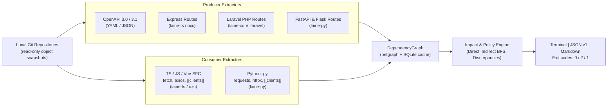

# Laine

Cross-repository API change impact analyzer written in Rust that pinpoints breaking contract changes and affected downstream consumers with exact file, line, and commit evidence—locally, deterministically, and without running untrusted code.

[](https://github.com/Klowsx/impact-analizer/actions/workflows/ci.yml)
[](./LICENSE)

---

## Architecture

Laine reads Git snapshots directly from local object databases (`git cat-file --batch`, never mutating working trees or installing dependencies), normalizes producer contracts and consumer HTTP calls into a language-agnostic Intermediate Representation (IR), and evaluates breaking changes over a directed `petgraph` dependency graph.



---

## Supported Languages & Frameworks

| Side | Language / Format | Frameworks & Clients | What Laine Extracts |
|---|---|---|---|
| **Producer** | OpenAPI 3.0 / 3.1 (YAML & JSON) | **Any backend language** (Go, Java, Rust, .NET, Node, Python, PHP, ...) | Endpoint removals, 2xx response field removals & type changes, newly required or type-changed JSON request fields, newly required `query`/`header`/`path`/`cookie` parameters |
| **Producer** | TypeScript / JavaScript | **Express** (`app.<method>`, `router.<method>`, `router.route().get()`, `app.use('/prefix', router)`) | Code-defined HTTP endpoints + OpenAPI-vs-code discrepancy detection |
| **Producer** | PHP | **Laravel** (`routes/api.php`, `routes/web.php`, `Route::prefix`, `Route::group`, `Route::match`, `Route::any`) | Code-defined HTTP endpoints + OpenAPI-vs-code discrepancy detection |
| **Producer** | Python | **FastAPI** (`@app.<method>`, `@router.api_route`, `APIRouter`, `include_router`) & **Flask** (`@app.route`, `Blueprint`, `register_blueprint`) | Code-defined HTTP endpoints + OpenAPI-vs-code discrepancy detection |
| **Consumer** | TypeScript / JavaScript / Vue SFC (`.vue`) | `fetch`, `axios`, `axios.create({ baseURL })`, custom wrappers (`[[clients]]` like `$fetch`, `getClient().fetch`, `apiClient`), React Query / SWR / Nuxt `useAsyncData` / Vue `ref` | Endpoint calls, intra-file & **cross-file interprocedural dataflow** (`service.js -> hook/store -> Component.jsx/.vue`, JSX props, Vue `<template>`, `tsconfig`/`jsconfig` aliases), function return types (`Promise<T>`), Zod runtime schemas (`z.object`, `z.infer`), generic response types (`LIKELY`), dynamic URLs (`UNKNOWN`) |
| **Consumer** | Python (`.py`) | `requests`, `requests.Session`, `httpx`, `httpx.Client` / `httpx.AsyncClient(base_url=...)`, custom wrappers (`[[clients]]`) | Endpoint calls, `os.getenv` / `os.environ` resolution, f-string URLs, `.json()` dict subscripts (`customer["fullName"]`), `.get()` / `.pop()`, list indexing, dynamic URLs (`UNKNOWN`) |

---

## Quickstart

### Build or Install

```bash
# Build from source (Rust 1.85+ / Edition 2024)
cargo install --path crates/laine-cli

# Or run directly in this workspace
cargo run -p laine-cli -- --help
```

Prebuilt single-file binaries for Linux (`x86_64`), macOS (`aarch64`), and Windows (`x86_64`) are published on [GitHub Releases](https://github.com/Klowsx/impact-analizer/releases).

### Try the Reproducible 4-Repository Demo

```bash
# 1. Materialize 4 independent Git repos (customer, billing, notification, shipping)
laine demo-setup ./fixtures/demo-workspace

# 2. Pre-warm the SQLite incremental extraction index (optional)
laine index --config ./fixtures/demo-workspace/laine.toml

# 3. Analyze breaking impact (terminal output; exits with code 2 on breaking change)
laine analyze \
  --config ./fixtures/demo-workspace/laine.toml \
  --repo customer-service \
  --base main \
  --head feature/split-customer-name

# 4. Emit deterministic schema_version=1 JSON or PR-ready Markdown
laine analyze \
  --config ./fixtures/demo-workspace/laine.toml \
  --repo customer-service \
  --base main \
  --head feature/split-customer-name \
  --format json

laine analyze \
  --config ./fixtures/demo-workspace/laine.toml \
  --repo customer-service \
  --base main \
  --head feature/split-customer-name \
  --format markdown
```

### Initialize Your Own Workspace

```bash
laine init
laine repo add ./customer-service --openapi openapi.yaml --base-url http://customer-service
laine repo add ./billing-service --base-url http://billing-service
laine repo add ./laravel-api --framework laravel --base-url https://api.internal
laine index --config laine.toml
```

---

## Configuration (`laine.toml`)

```toml
version = 1
cache_path = ".cache/laine.sqlite"

[env]
VITE_API_URL = "https://api.company.internal"
CUSTOMER_SERVICE_URL = "http://customer-service"

[policy]
# Minimum finding severity that exits with code 2: low | medium | high | critical
fail_on = "high"
ignore_endpoints = ["/health", "/internal/*"]
fail_on_unresolved = false

[[services]]
name = "customer-service"
path = "./customer-service"
openapi = "openapi.yaml"
base_urls = [
  "http://customer-service",
  "https://api.company.internal/customers"
]

[services.routes]
framework = "express"   # express | laravel | fastapi | flask
files = ["src/routes/customers.ts"]
prefix = "/api"

[[services]]
name = "web-portal"
path = "./web-portal"

[[services]]
name = "python-worker"
path = "./python-worker"

[[clients]]
callee = "getClient().fetch"
target_service = "customer-service"
path_prefix = "/api"
```

---

## GitHub Action (PR Comments & CI Gating)

Laine ships an official composite GitHub Action (`action.yml`) that runs impact analysis on Pull Requests, posts or updates a single sticky comment (`<!-- laine-impact-report -->`), and fails the check with exit code `2` when breaking changes violate `[policy]`:

```yaml
name: Cross-Repo Impact Check

on:
  pull_request:
    branches: [main]

permissions:
  contents: read
  pull-requests: write

jobs:
  laine:
    runs-on: ubuntu-latest
    steps:
      - name: Checkout producer repository
        uses: actions/checkout@v4
        with:
          path: customer-service
          fetch-depth: 0

      - name: Checkout consumer repositories
        uses: actions/checkout@v4
        with:
          repository: your-org/billing-service
          path: billing-service

      - name: Run Laine impact analysis
        uses: Klowsx/impact-analizer@v0.1.0
        with:
          config: laine.toml
          repo: customer-service
          base: ${{ github.event.pull_request.base.sha }}
          head: ${{ github.event.pull_request.head.sha }}
          format: markdown
          comment-pr: "true"
          laine-version: v0.1.0
```

---

## Performance & Determinism

- **Batched Git object reads (`git cat-file --batch`):** Reading 182 source files from a real repository dropped from **15.5 s** (per-file `git show` spawning) to **840 ms** in unoptimized debug builds—an **18.5× speedup** before release optimizations.
- **Parallel extraction & incremental caching:** Consumer repositories and files are analyzed in parallel with `rayon`, and per-repository extraction snapshots are cached by `(repo, commit_sha, config_hash, schema_version)` in an embedded SQLite database (`rusqlite`) populated by `laine index` or `laine analyze`.
- **Byte-for-byte deterministic JSON:** All contract maps, findings, and consumer hits use ordered `BTreeMap` structures and explicit stable sorting with zero wall-clock fields inside `schema_version: 1` JSON output.

---

## Workspace Layout

- [`crates/laine-core`](./crates/laine-core) — Domain model, normalized IR, `laine.toml` & policy engine, Git batch reader, OpenAPI diffing, Laravel PHP route scanner, `petgraph` dependency graph, SQLite cache, and impact engine.
- [`crates/laine-ts`](./crates/laine-ts) — TypeScript, JavaScript, Vue SFC, and Express analyzer built on `oxc`.
- [`crates/laine-py`](./crates/laine-py) — Python FastAPI/Flask route extractor and `requests`/`httpx` consumer analyzer.
- [`crates/laine-cli`](./crates/laine-cli) — `laine` binary (`init`, `repo add`, `index`, `demo-setup`, `analyze`) and terminal/JSON/Markdown reporters.

---

## Documentation

- [IR & JSON Report Specification (`schema_version: 1`)](./docs/ir-spec.md)
- [ADR-001: Choosing Rust + Oxc](./docs/adr/001-rust-and-oxc.md)
- [ADR-002: Deterministic IR and Certainty vs. Severity Model](./docs/adr/002-deterministic-ir-and-certainty.md)
- [ADR-003: Multi-Language Architecture](./docs/adr/003-multi-language-architecture.md)
- [Product Plan & Roadmap](./PLAN.md)
- [Contributing Guide](./CONTRIBUTING.md)
- [License (MIT)](./LICENSE)
