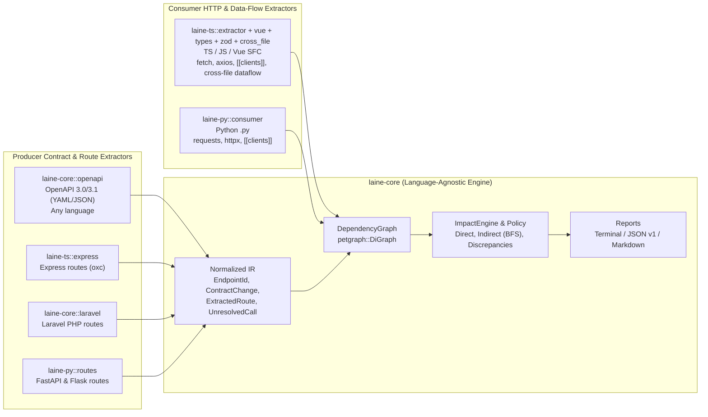

# ADR-003: Multi-Language Architecture Converging on a Unified Dependency Graph

- **Status:** Accepted
- **Date:** 2026-11-24

## Context

Production microservice architectures are rarely homogeneous. A single organization commonly maintains:
- Backend services in **PHP (Laravel)**, **Python (FastAPI / Flask)**, **Node.js (Express)**, or **Go/Java/Rust** documented with **OpenAPI 3.0/3.1**.
- Consumer services and frontends in **TypeScript / JavaScript / Vue SFCs (`.vue`)** and **Python (`requests` / `httpx`)**.

If impact analysis logic were coupled to any single AST or framework, every new language would duplicate route matching, graph traversal, indirect propagation, policy evaluation, and report generation.

## Decision

Separate Laine into **language- and contract-specific extractors** that emit normalized Intermediate Representation (IR) records into a single language-agnostic **`DependencyGraph` (`petgraph::DiGraph`)** and **`ImpactEngine`** in `laine-core`.

## Extractor Responsibilities

### 1. TypeScript, JavaScript, Vue SFC, and Express (`crates/laine-ts`)

Built on **`oxc`** (`oxc_parser`, `oxc_semantic`, `oxc_ast_visit`) for native-speed AST parsing with zero dependency on Node.js or `node_modules`:

- **Vue Single File Components (`vue.rs`):** `extract_vue_scripts` extracts every `<script>` and `<script setup>` block (detecting `lang="ts"` / `lang="tsx"` vs JavaScript and skipping HTML comments), padding leading `\n` newlines so every extracted HTTP call and field read retains its exact 1-based `.vue` line number. `extract_vue_template_expressions` also scans `<template>` blocks (`{{ ... }}`, `:attr` / `v-bind`, `v-if` / `v-else-if`, `v-show`, `v-for`) to capture field reads rendered directly in templates.
- **Consumer Extraction (`extractor.rs` & `url.rs`):** Tracks `fetch`, `axios`, `axios.create({ baseURL })`, custom wrappers (`[[clients]]` such as `$fetch`, `getClient().fetch`, `apiClient`), Vue `ref()` / `shallowRef()` / `computed()` / `useFetch()`, and `[env]` substitutions (`process.env.*`, `import.meta.env.*`). Performs AST data-flow tracking for direct property reads, destructuring, local aliases, optional chaining, 1-level local helper propagation (`Confidence::Confirmed`), and enclosing function/method/arrow `: Promise<T>` return-type annotations (`Confidence::Likely`). Unresolvable dynamic URLs are recorded as `UNKNOWN`.
- **Generic Type Contracts & Zod Runtime Schemas (`types.rs`, `zod.rs`):** Repo-wide passes index TypeScript `interface` / `type` definitions and Zod runtime schemas (`z.object`, `.extend`, `.merge`, `.pick`, `.omit`, `z.infer`, `.parse` / `.safeParse`), linking schema fields into the graph even when fields are validated at runtime or consumed via typed contracts (`Confidence::Likely`).
- **In-Memory Module Resolution & Cross-File Interprocedural Dataflow (`module_resolver.rs`, `cross_file.rs`):** Reads `tsconfig*.json` / `jsconfig*.json` (pure-Rust JSONC parser supporting `baseUrl`, `paths`, `extends`, `${configDir}`, Nuxt `.nuxt/tsconfig.json`, and `@/`/`~/` aliases) directly from Git snapshots without touching `node_modules`. A 3-pass summary-based engine builds per-file `ModuleSummary` records, runs a bounded 6-hop cycle-safe fixed-point propagation across ESM imports, re-exports, barrels, CommonJS `require`/`module.exports`, service objects, classes, React Query / SWR / Nuxt hooks, and emits cross-file reads across consumer files, helper calls, JSX props (`<UserCard user={user} />`), and Vue `<template>` expressions with full multi-file evidence traces.
- **Express Producer Routes (`express.rs`):** Extracts `app.<method>`, `router.<method>`, chained `router.route('/path').get(...).post(...)`, and `app.use('/prefix', subRouter)` mount prefixes.

### 2. Python FastAPI, Flask, `requests`, and `httpx` (`crates/laine-py`)

Implemented as a self-contained, zero-runtime Rust scanner that strips `#` comments and triple-quoted docstrings while preserving exact 1-based line numbers—requiring no Python interpreter or virtual environment:

- **Producer Routes (`routes.rs`):**
  - **FastAPI (`extract_fastapi_routes`):** Recognizes `@app.<method>`, `@router.api_route(..., methods=[...])`, `APIRouter(prefix=...)`, and `app.include_router(router, prefix=...)` regardless of declaration order, normalizing `{id}` and typed `{id:int}` parameters.
  - **Flask (`extract_flask_routes`):** Recognizes `@app.route(..., methods=[...])`, `@bp.<method>`, `Blueprint(..., url_prefix=...)`, and `app.register_blueprint(bp, url_prefix=...)`, normalizing `<id>`, `<int:id>`, and `<string:slug>` converters.
- **Consumer Extraction (`consumer.rs`):**
  - Uses indentation-based function/class scoping to track `requests.<method>`, `requests.Session()`, `httpx.<method>`, `httpx.Client(base_url=...)`, `httpx.AsyncClient(base_url=...)`, `with` / `async with` context managers, and configured `[[clients]]`.
  - Resolves `os.getenv(...)`, `os.environ.get(...)`, and `os.environ["..."]` against `[env]`, evaluates f-string and `+` concatenated URLs, and surfaces unresolvable URLs as `UNKNOWN`.
  - Tracks `.json()` payloads, dictionary subscripts (`customer["fullName"]`), `.get("email")` / `.pop(...)`, nested object/list indexing (`data["items"][0]["name"]`), and local variable aliases.

### 3. Laravel PHP Producer Routes (`crates/laine-core/src/laravel.rs`)

A lightweight, line-preserving PHP scanner (`extract_laravel_routes`) strips `//`, `#`, and `/* ... */` comments and maintains a brace-depth prefix stack to extract:
- `Route::get/post/put/patch/delete('path', ...)`
- `Route::match(['get', 'post'], 'path', ...)` and `Route::any('path', ...)`
- Nested `Route::prefix('...')->group(function () { ... })`, `Route::group(['prefix' => '...'], ...)`, and chained `->prefix('...')` inside controller/middleware groups
- Optional route parameters (`{id?}`) normalized via `laine_core::routes::normalize_route_path`

### 4. OpenAPI 3.0/3.1 Contract Analyzer (`crates/laine-core/src/openapi.rs`)

Provides language-agnostic producer coverage for **any** backend language (Go, Java, Rust, .NET, Ruby, etc.) by parsing YAML or JSON OpenAPI documents, resolving internal `$ref` pointers, and diffing:
- Removed endpoints (`endpoint_removed`)
- Removed or type-changed 2xx JSON response fields (`response_field_removed`, `response_field_type_changed`)
- Newly required or type-changed JSON request body fields (`request_field_added_required`, `request_field_type_changed`)
- Newly required parameters in `query`, `header`, `path`, or `cookie` (`required_parameter_added`)

When a service configures both `openapi` and code-based `routes`, `laine_core::routes::detect_openapi_discrepancies` cross-checks both sources to report `undocumented_in_openapi` and `missing_in_code` drift.

## How All Extractors Converge in `laine-core`

Every extractor reduces its output to the exact same canonical contract:

1. **Canonical Endpoint Identity:** All route styles (`{id}`, `{id?}`, `{id:int}`, `<int:id>`, `:id`, `${id}`) normalize to `:id` for display and `/segment/*` (`canonical_route_key`) for matching. A Laravel PHP route `Route::get('/customers/{id}', ...)` automatically matches a Vue/TS `fetch(\`${API}/customers/${id}\`)` and a Python `httpx.get(f"{BASE}/customers/{customer_id}")`.
2. **Unified Graph Operations:** `laine-cli::engine` feeds all producer endpoints/fields (`add_endpoint`, `add_schema_field`) and consumer links (`link_consumes`, `link_reads_field`, `link_reads_field_with_confidence`) into one `DependencyGraph`.
3. **Single Impact & Policy Engine:** `analyze_impact` operates exclusively on `DependencyGraph`, `Vec<ContractChange>`, `Vec<UnresolvedCall>`, and `Vec<ContractDiscrepancy>`. Cycle-safe transitive BFS (`indirect_consumers`), deterministic sorting, policy gating, and terminal/JSON/Markdown rendering work identically for every language combination.

## Trade-offs & Consequences

- **Why `oxc` for TS/JS vs. custom scanners for Python & Laravel PHP:** JavaScript/TypeScript consumer code relies heavily on closures, destructuring, JSX/TSX, and type definitions where a full compiler-grade AST (`oxc`) pays immediate dividends. By contrast, Laravel route files and Python HTTP call/decorator patterns have compact, regular syntax where zero-dependency Rust scanners deliver fast, deterministic line-accurate extraction without inflating binary size or build complexity.
- **Adding future languages is additive:** Adding Go, Java, or Rust consumer/producer extractors (for example via `tree-sitter` crates in Phase 5) only requires emitting `ExtractedRoute` or calling `DependencyGraph::link_consumes` / `link_reads_field`—zero changes are needed in `DependencyGraph`, `ImpactEngine`, policy evaluation, or the `schema_version: 1` JSON report.
- **Explicit precision boundaries:** Patterns outside static reach (reflection, dynamic routing tables, runtime URL assembly) are never guessed; every extractor reports them honestly as `UnresolvedCall` (`UNKNOWN`).
